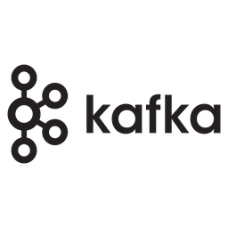
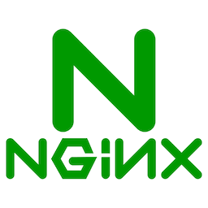
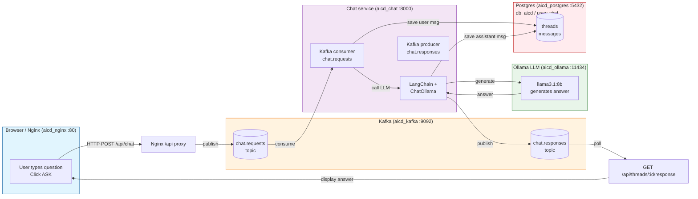

# AI Cloud Data (AICD) platform

A collection of tools running locally on Docker Desktop to deploy, manage and run your Cloud, Data & AI Applications;

Table Of Content
 * [Services](#services)
 * [Install](#install)
 * [Local Domain](#local-domain)

Components
 * [Ollama](#ollama)
 * [Postgres](#postgres)
 * [pgAdmin](#pgadmin)
 * [Kafka](#kafka)
 * [Kafka UI](#kafka-ui)
 * [Nginx](#nginx)
 * [LangChain](#langchain)
 * [Chat](#chat)

<a id="services"></a>
## Services

| Services  | Description  |
|---|---|
|   | [Ollama](#ollama) is the engine that brings large language models (LLMs) to your desktop. It allows you to download, run, and manage open-source models like Llama 3 directly on your local machine, eliminating the need for expensive cloud services. Ollama simplifies the entire process, making it easy to experiment with different models for your AI applications.  |
|   | [Postgres](#postgres) is a powerful, open-source relational database. While it's known for its reliability and robustness in storing traditional, structured data, it also plays a critical role in modern AI stacks. In this context, Postgres is used to manage the metadata and structured information associated with your AI application, providing a solid foundation for user data, logs, and other critical backend needs.  |
|   | [pgAdmin](#pgadmin) is the administration and management tool for PostgreSQL databases. | 
|    | [Kafka](#kafka)  is a distributed, high-throughput event streaming and message-broker platform available at Apache Kafka. It acts as an intermediary between data producers and consumers by storing and routing data streams in real time. | 
|    | [Kafka UI](#kafka-ui) is a web-based UI to manage Kafka topics, consumers, and messages. | 
|   | [Nginx](#nginx) is a high-performance, open-source HTTP web server, reverse proxy, content cache, and load balancer. In this platform, Nginx serves the **chat web interface** (HTML/CSS/JS). |
|   | [Chat](#chat) is the AI chat service powered by **LangChain** and Ollama. It manages persistent threads, conversation history in Postgres, and communicates via Kafka. |

Lineup:
 - ollama/ollama:0.34.4
 - postgres:18.6
 - dpage/pgadmin4:9.18.0
 - apache/kafka:4.3.1
 - kafbat/kafka-ui:f2a4f9b
 - aicd-nginx:1.1.1
 - aicd-chat:1.0.0
 - nginx:1.31.7-alpine

Image versioning
----------------
The two custom images are versioned independently with a single version name, hardcoded in their respective `docker-compose.yml` files:

| Service | Image | File |
|---------|-------|------|
| Chat | `aicd-chat:1.0.0` | `Chat/docker-compose.yml` |
| Nginx | `aicd-nginx:1.1.1` | `Nginx/docker-compose.yml` |

<a id="install"></a>
## Install

clone this repository locally
```
git clone https://github.com/heibalvin/AICD.git
```

copy `sample.env` into `.env`. update the environment variables for DOMAIN / USER / PASSWORD.
```
# DOMAIN
DOMAIN=local.akashatek.com

# OLLAMA
OLLAMA_HOST=aicd_ollama

# POSTGRES
POSTGRES_HOST=aicd_postgres
POSTGRES_USER=postgres
POSTGRES_PASSWORD=postgres
POSTGRES_DB=default
POSTGRES_URI=postgresql://${POSTGRES_USER}:${POSTGRES_PASSWORD}@${POSTGRES_HOST}:5432/${POSTGRES_DB}

# POSTGRES AICD
POSTGRES_AICD_USER=aicd
POSTGRES_AICD_PASSWORD=aicd
POSTGRES_AICD_DB=aicd

# PGADMIN 
PGADMIN_DEFAULT_EMAIL=admin@local.akashatek.com
PGADMIN_DEFAULT_PASSWORD=admin

# KAFKA
KAFKA_HOST=aicd_kafka
KAFKA_CLUSTER_ID=aicd_kafka
```

start the services
```
docker compose up -d
```

<a id="domain"></a>
## Local Domain

The whole deployment is served under `local.akashatek.com`. Before changing Cloudflare or SquareSpace DNS, test locally by mapping the domain to your machine:

### 1. Add to `/etc/hosts`

```
sudo sh -c 'echo "127.0.0.1 local.akashatek.com" >> /etc/hosts'
```

This only affects your machine and does not touch `www.akashatek.com`, MX, or
Google Workspace records at SquareSpace.

### 2. Start

```
docker compose up -d
```

### Routing under `local.akashatek.com`

| Port | Service |
|------|---------|
| 80 | Nginx Chat Frontend |
| 11434 | Ollama |
| 9092 | Kafka |
| 8081 | Kafka UI |
| 5432 | Postgres (TCP) |
| 8082 | pgAdmin |
| 8000 | Chat Backend API |

Cloudflare Tunnel and SquareSpace DNS can be added later to expose
`local.akashatek.com` externally. Until then, `/etc/hosts` keeps traffic local.


<a id="ollama"></a>
## Ollama

```bash
# Generate a completion
curl -s http://localhost:11434/api/generate -d '{
  "model": "llama3.1:8b",
  "prompt": "hello",
  "stream": false
}' | jq .
```

<a id="postgres"></a>
## Postgres

Postgres is exposed directly on port 5432.

```bash
# From inside the container
docker exec aicd_postgres psql -U aicd -d aicd -c "SELECT 1;"

# List databases
docker exec aicd_postgres psql -U aicd -d aicd -c "\l"
```

<a id="pgadmin"></a>
## pgAdmin

pgAdmin is available at `http://localhost:8082`.

Log in with:
* **Email:** `admin@local.akashatek.com` (from `PGADMIN_DEFAULT_EMAIL`)
* **Password:** `admin` (from `PGADMIN_DEFAULT_PASSWORD`)

### Add the AICD Postgres server (manual)

1. Open `http://localhost:8082` and log in.
2. In the Browser tree, right-click **Servers** → **Create** → **Server…**
3. **General** tab → Name: `AICD Postgres`
4. **Connection** tab:
   * Host name/address: `aicd_postgres`
   * Port: `5432`
   * Maintenance database: `aicd`
   * Username: `aicd`
   * Password: `aicd`
5. Click **Save**.

### Automation

A `pgadmin_servers.json` is mounted into the pgAdmin container at
`/pgadmin4/servers.json`. On first start, pgAdmin may pre-populate the server
list from this file. If it does not appear, add the server manually using the
steps above.

<a id="kafka"></a>
## Kafka

```bash
# Create a topic
docker exec aicd_kafka /opt/kafka/bin/kafka-topics.sh --create --topic test --bootstrap-server localhost:9092

# Produce a message
echo "hello" | docker exec -i aicd_kafka /opt/kafka/bin/kafka-console-producer.sh --topic test --bootstrap-server localhost:9092

# Consume messages
docker exec aicd_kafka /opt/kafka/bin/kafka-console-consumer.sh --topic test --from-beginning --bootstrap-server localhost:9092 --max-messages 1
```

<a id="kafka-ui"></a>
## Kafka UI

Kafka UI is available at `http://localhost:8081`, connected to Kafka on `aicd_kafka:9092`.

Topics `chat.requests` and `chat.responses` are auto-created on first use
(`KAFKA_AUTO_CREATE_TOPICS_ENABLE=true`). If they do not appear in Kafka UI,
create them manually:

```bash
docker exec aicd_kafka /opt/kafka/bin/kafka-topics.sh --create --topic chat.requests --bootstrap-server localhost:9092
docker exec aicd_kafka /opt/kafka/bin/kafka-topics.sh --create --topic chat.responses --bootstrap-server localhost:9092
```

<a id="nginx"></a>
## Nginx

Nginx serves the **chat web interface** at `http://localhost:80`.

```bash
# Nginx on port 80
curl -s -o /dev/null -w "%{http_code}\n" http://localhost/
```

<a id="langchain"></a>
## LangChain

LangChain is the framework used by the **Chat service** (`aicd_chat`) to orchestrate
LLM interactions. It provides:
- **ChatOllama** integration for calling Ollama's REST API
- **Prompt templates** for system/user/assistant message formatting
- **Message history** management via custom Postgres-backed memory
- **Chain composition** for request → LLM → response flow

```bash
# LangChain runs inside aicd_chat container
# No external port exposed; invoked via FastAPI /api/chat
```

<a id="chat"></a>
## Chat

Ollama-powered chat with persistent threads and conversation history stored in Postgres (`aicd` database, user `aicd`).
Messaging between **Nginx** and **Chat** flows through Kafka.

Frontend UI: `http://localhost:80` (`aicd_nginx`)
Backend API: `http://localhost:8000` (`aicd_chat`)

### Architecture



### Message Flow

1. User types a question and clicks **ASK**.
2. **Nginx** POSTs to `/api/chat`, which publishes the request to Kafka topic `chat.requests`.
3. **Chat** consumes `chat.requests`, saves the user message to Postgres, calls Ollama via LangChain, saves the assistant answer to Postgres, and publishes the response to Kafka topic `chat.responses`.
4. **Nginx** polls `/api/threads/{id}/response` and displays the answer in the dialog center.

---

### Chat / Postgres Interface

The **Chat service** uses **Postgres** (database `aicd`, user `aicd`) for persistent storage of threads and messages. Tables are auto-created on startup.

#### Schema

```sql
-- threads table: stores chat threads
CREATE TABLE IF NOT EXISTS threads (
    id TEXT PRIMARY KEY,
    title TEXT,
    created_at TIMESTAMPTZ DEFAULT NOW(),
    updated_at TIMESTAMPTZ DEFAULT NOW()
);

-- messages table: stores all messages linked to threads
CREATE TABLE IF NOT EXISTS messages (
    id TEXT PRIMARY KEY,
    thread_id TEXT NOT NULL REFERENCES threads(id) ON DELETE CASCADE,
    role TEXT NOT NULL CHECK (role IN ('user', 'assistant')),
    content TEXT NOT NULL,
    created_at TIMESTAMPTZ DEFAULT NOW()
);

-- index for efficient message retrieval by thread
CREATE INDEX IF NOT EXISTS idx_messages_thread_id
ON messages(thread_id, created_at);
```

#### Operations

| Operation | SQL |
|-----------|-----|
| **Create thread** | `INSERT INTO threads (id, title) VALUES (%s, %s) RETURNING id, title, created_at, updated_at` |
| **List threads** | `SELECT id, title, created_at, updated_at FROM threads ORDER BY updated_at DESC` |
| **Get thread** | `SELECT id, title, created_at, updated_at FROM threads WHERE id = %s` |
| **Add message** | `INSERT INTO messages (id, thread_id, role, content) VALUES (%s, %s, %s, %s) RETURNING id, thread_id, role, content, created_at` |
| **Get messages** | `SELECT id, thread_id, role, content, created_at FROM messages WHERE thread_id = %s ORDER BY created_at ASC` |
| **Latest assistant msg** | `SELECT id, thread_id, role, content, created_at FROM messages WHERE thread_id = %s AND role = 'assistant' ORDER BY created_at DESC LIMIT 1` |
| **Delete thread** | `DELETE FROM threads WHERE id = %s` (cascades to messages) |

All timestamps use `TIMESTAMPTZ` (UTC). UUIDs are generated in Python (`uuid.uuid4()`). Connections use `psycopg.AsyncConnection` with retry logic.

---

### Chat / Kafka Topics and Messages

The **Chat service** uses **two Kafka topics** for async request/response flow.

#### Topics

| Topic | Partitions | Retention | Purpose |
|-------|------------|-----------|---------|
| `chat.requests` | 1 (default) | 7 days | Incoming chat requests from Nginx |
| `chat.responses` | 1 (default) | 7 days | Outgoing responses to Nginx |

Auto-created via `KAFKA_AUTO_CREATE_TOPICS_ENABLE=true`.

#### Message Format

**`chat.requests`** (produced by Nginx `/api/chat`, consumed by Chat):
```json
{
  "thread_id": "uuid-string",
  "message": "User's question text",
  "model": "llama3.1:8b"
}
```

**`chat.responses`** (produced by Chat, polled by Nginx via `/api/threads/{id}/response`):
```json
{
  "thread_id": "uuid-string",
  "response": "Assistant's generated answer text"
}
```

#### Consumer Group
- Group ID: `aicd_chat`
- Auto-commit: enabled
- Offset reset: earliest

---

### Chat / Ollama Interface

The **Chat service** calls Ollama via **LangChain's `ChatOllama`** class.

#### Configuration
- **Base URL**: `http://aicd_ollama:11434` (internal Docker network)
- **Model**: Configurable per request (default `llama3.1:8b`)
- **Streaming**: Disabled (`stream: false`) for simplicity

#### Request Flow
```python
# Inside aicd_chat (Chat/main.py -> llm.py)
from langchain_ollama import ChatOllama
from langchain_core.messages import HumanMessage, AIMessage, SystemMessage

llm = ChatOllama(model="llama3.1:8b", base_url="http://aicd_ollama:11434")

messages = [
    SystemMessage(content="You are a helpful AI assistant..."),
    # ...conversation history from Postgres...
    HumanMessage(content="User's current question")
]

result = await llm.ainvoke(messages)
answer = result.content
```

#### Prompt Structure
```
System: You are a helpful AI assistant. Answer clearly and concisely.
User: (history message 1)
Assistant: (history answer 1)
User: (history message 2)
...
User: (current question)
```

Full conversation history is fetched from Postgres (`messages` table) and converted to LangChain message objects before each call.

---

### Chat / Nginx API Commands

The Nginx (`aicd_nginx` on port 80) proxies `/api/*` to the Chat service (`aicd_chat:8000`).

#### Endpoints

| Method | Endpoint | Description |
|--------|----------|-------------|
| GET | `/api/threads` | List all threads (most recent first) |
| POST | `/api/threads` | Create a new thread (`{ "title": "optional" }`) |
| GET | `/api/threads/{id}` | Get thread with full message history |
| DELETE | `/api/threads/{id}` | Delete a thread and its messages |
| POST | `/api/chat` | Queue a chat request to Kafka (`chat.requests`) |
| GET | `/api/threads/{id}/response` | Poll for latest assistant response |

#### Request/Response Examples

**List threads**
```bash
curl -s http://localhost:8000/api/threads | jq .
# Response: [{"id":"uuid","title":"Global Chat","updated_at":"2026-11-16T..."}]
```

**Create thread**
```bash
curl -s -X POST http://localhost:8000/api/threads \
  -H 'Content-Type: application/json' \
  -d '{"title":"My new thread"}' | jq .
# Response: {"id":"uuid","title":"My new thread","updated_at":"..."}
```

**Create thread (default name "Global Chat")**
```bash
curl -s -X POST http://localhost:8000/api/threads \
  -H 'Content-Type: application/json' \
  -d '{}' | jq .
```

**Send message (queued to Kafka)**
```bash
curl -s -X POST http://localhost:8000/api/chat \
  -H 'Content-Type: application/json' \
  -d '{
    "thread_id": "<thread-uuid>",
    "message": "What is LangChain?",
    "model": "llama3.1:8b"
  }' | jq .
# Response: {"thread_id":"<thread-uuid>","status":"queued"}
```

**Poll for answer**
```bash
curl -s http://localhost:8000/api/threads/<thread-uuid>/response | jq .
# Pending: {"thread_id":"...","response":null,"status":"pending"}
# Done:    {"thread_id":"...","response":"LangChain is a framework...","created_at":"...","status":"done"}
```

**Get thread with messages**
```bash
curl -s http://localhost:8000/api/threads/<thread-uuid> | jq .
# Response: {"thread":{...},"messages":[{"role":"user","content":"..."},{"role":"assistant","content":"..."}]}
```

**Delete thread**
```bash
curl -s -X DELETE http://localhost:8000/api/threads/<thread-uuid> | jq .
# Response: {"status":"deleted"}
```

---

### Frontend Layout

- **Topbar** — Service links (Nginx Chat, Ollama, Kafka, Kafka UI, Postgres, pgAdmin) with large logos and port numbers.
- **Left panel** — Thread list: create new threads, switch between threads, delete threads. Auto-creates "Global Chat" if missing.
- **Center panel** — Chat history for selected thread (user messages right, assistant left). Shows "Pushing to Kafka..." / "Received from Kafka → Ollama" status.
- **Bottom panel** — Model selector, question textarea, ASK button (Enter to send).
- **Bottom-left** — Toggleable log panel showing Kafka push/receive events.

---

### Debug: Nginx Ask → Kafka UI → Chat log → Ollama log → Postgres chain

To trace a full request end-to-end:

1. **Nginx** — open `http://localhost:80`, type a question, click ASK. The question appears in the dialog center.
2. **Kafka UI** — open `http://localhost:8081`, inspect topic `chat.requests` to confirm the request message was produced, then topic `chat.responses` for the reply.
3. **Chat service logs** — verify the consumer picked up the request:
   ```
   docker logs aicd_chat
   ```
4. **Ollama logs** — verify the LLM call:
   ```
   docker logs aicd_ollama
   ```
5. **Postgres** — verify both user and assistant messages were stored:
   ```
   docker exec aicd_postgres psql -U aicd -d aicd -c "SELECT id, thread_id, role, content, created_at FROM messages ORDER BY created_at DESC LIMIT 5;"
   ```

Conversation history and threads are persisted in the `aicd_postgres` database (`threads` and `messages` tables, database `aicd`, user `aicd`).