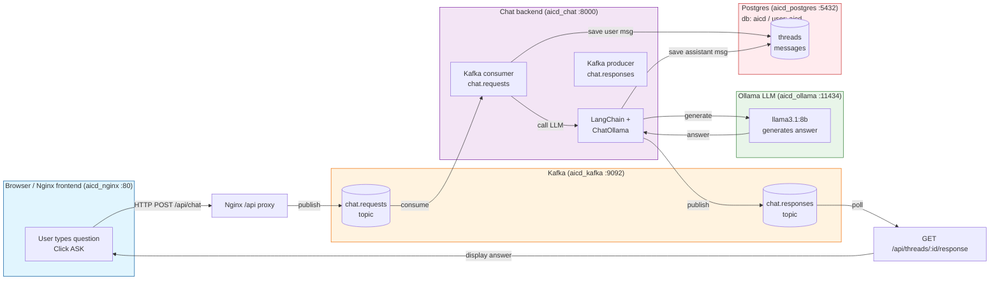

# AI Cloud Data (AICD) platform

A collection of tools running locally on Docker Desktop to deploy, manage and run your Cloud, Data & AI Applications;

Table Of Content
 * [Services](#services)
 * [Install](#install)
 * [Local Domain](#local-domain)

Components
 * [Ollama](#ollama)
 * [Postgres](#postgres)
 * [pgAdmin](#pgadmin)
 * [Kafka](#kafka)
 * [Kafka UI](#kafka-ui)
 * [Nginx](#nginx)
 * [Chat](#chat)

<a id="services"></a>
## Services

| Services  | Description  |
|---|---|
|   | [Ollama](#ollama) is the engine that brings large language models (LLMs) to your desktop. It allows you to download, run, and manage open-source models like Llama 3 directly on your local machine, eliminating the need for expensive cloud services. Ollama simplifies the entire process, making it easy to experiment with different models for your AI applications.  |
|   | [Postgres](#postgres) is a powerful, open-source relational database. While it's known for its reliability and robustness in storing traditional, structured data, it also plays a critical role in modern AI stacks. In this context, Postgres is used to manage the metadata and structured information associated with your AI application, providing a solid foundation for user data, logs, and other critical backend needs.  |
|   | [pgAdmin](#pgadmin) is the administration and management tool for PostgreSQL databases. | 
|    | [Kafka](#kafka)  is a distributed, high-throughput event streaming and message-broker platform available at Apache Kafka. It acts as an intermediary between data producers and consumers by storing and routing data streams in real time. | 
|    | [Kafka UI](#kafka-ui) is a web-based UI to manage Kafka topics, consumers, and messages. | 
|   | [Nginx](#nginx) is a high-performance, open-source HTTP web server, reverse proxy, content cache, and load balancer. Created by Igor Sysoev and released in 2004, it is currently one of the most widely used web servers in the world. |
|   | [Chat](#chat) is an Ollama-powered chat application with persistent threads and conversation history stored in Postgres, built with LangChain and FastAPI. |

Lineup:
 - ollama/ollama:0.34.4
 - postgres:18.6
 - dpage/pgadmin4:9.18.0
 - apache/kafka:4.3.1
 - kafbat/kafka-ui:f2a4f9b
 - aicd-nginx:1.0.0
 - aicd-chat:1.0.0
 - nginx:1.31.7-alpine

Image versioning
----------------
The two custom images are versioned independently with a single version name, hardcoded in their respective `docker-compose.yml` files:

| Service | Image | File |
|---------|-------|------|
| Chat backend | `aicd-chat:1.0.0` | `Chat/docker-compose.yml` |
| Nginx frontend | `aicd-nginx:1.1.1` | `Nginx/docker-compose.yml` |

The version is set directly in each `docker-compose.yml` (build arg `VERSION`) and recorded as an OCI image label (`org.opencontainers.image.version`).

To release a new build, change `VERSION` (e.g. `1.0.0` → `1.0.1`) in the corresponding `docker-compose.yml` and rebuild:

```
# Bump only chat
docker compose up -d --build chat

# Bump only nginx
docker compose up -d --build nginx
```

<a id="install"></a>
## Install

clone this repository locally
```
git clone https://github.com/heibalvin/AICD.git
```

copy `sample.env` into `.env`. update the environment variables for DOMAIN / USER / PASSWORD.
```
# DOMAIN
DOMAIN=local.akashatek.com

# OLLAMA
OLLAMA_HOST=aicd_ollama

# POSTGRES
POSTGRES_HOST=aicd_postgres
POSTGRES_USER=postgres
POSTGRES_PASSWORD=postgres
POSTGRES_DB=default
POSTGRES_URI=postgresql://${POSTGRES_USER}:${POSTGRES_PASSWORD}@${POSTGRES_HOST}:5432/${POSTGRES_DB}

# POSTGRES AICD
POSTGRES_AICD_USER=aicd
POSTGRES_AICD_PASSWORD=aicd
POSTGRES_AICD_DB=aicd

# PGADMIN 
PGADMIN_DEFAULT_EMAIL=admin@local.akashatek.com
PGADMIN_DEFAULT_PASSWORD=admin

# KAFKA
KAFKA_HOST=aicd_kafka
KAFKA_CLUSTER_ID=aicd_kafka
```

start the services
```
docker compose up -d
```

<a id="domain"></a>
## Local Domain

The whole deployment is served under `local.akashatek.com`. Before changing Cloudflare or SquareSpace DNS, test locally by mapping the domain to your machine:

### 1. Add to `/etc/hosts`

```
sudo sh -c 'echo "127.0.0.1 local.akashatek.com" >> /etc/hosts'
```

This only affects your machine and does not touch `www.akashatek.com`, MX, or
Google Workspace records at SquareSpace.

### 2. Start

```
docker compose up -d
```

### Routing under `local.akashatek.com`

| Port | Service |
|------|---------|
| 80 | Nginx / Chat frontend (aicd_nginx) |
| 11434 | Ollama |
| 9092 | Kafka |
| 8081 | Kafka UI |
| 5432 | Postgres (TCP) |
| 8082 | pgAdmin |
| 8000 | Chat backend API (aicd_chat) |

Cloudflare Tunnel and SquareSpace DNS can be added later to expose
`local.akashatek.com` externally. Until then, `/etc/hosts` keeps traffic local.


<a id="ollama"></a>
## Ollama

```bash
# Generate a completion
curl -s http://local.akashatek.com:11434/api/generate -d '{
  "model": "llama3.1:8b",
  "prompt": "hello",
  "stream": false
}' | jq .
```

<a id="postgres"></a>
## Postgres

Postgres is exposed directly on port 5432.

```bash
# From inside the container
docker exec aicd_postgres psql -U aicd -d aicd -c "SELECT 1;"

# List databases
docker exec aicd_postgres psql -U aicd -d aicd -c "\l"
```

<a id="pgadmin"></a>
## pgAdmin

pgAdmin is available at `http://localhost:8082`.

Log in with:
* **Email:** `admin@local.akashatek.com` (from `PGADMIN_DEFAULT_EMAIL`)
* **Password:** `admin` (from `PGADMIN_DEFAULT_PASSWORD`)

### Add the AICD Postgres server (manual)

1. Open `http://localhost:8082` and log in.
2. In the Browser tree, right-click **Servers** → **Create** → **Server…**
3. **General** tab → Name: `AICD Postgres`
4. **Connection** tab:
   * Host name/address: `aicd_postgres`
   * Port: `5432`
   * Maintenance database: `default` (or `aicd`)
   * Username: `postgres`
   * Password: `postgres`
5. Click **Save**.

### Automation

A `pgadmin_servers.json` is mounted into the pgAdmin container at
`/pgadmin4/servers.json`. On first start, pgAdmin may pre-populate the server
list from this file. If it does not appear, add the server manually using the
steps above.

<a id="kafka"></a>
## Kafka

```bash
# Create a topic
docker exec aicd_kafka /opt/kafka/bin/kafka-topics.sh --create --topic test --bootstrap-server localhost:9092

# Produce a message
echo "hello" | docker exec -i aicd_kafka /opt/kafka/bin/kafka-console-producer.sh --topic test --bootstrap-server localhost:9092

# Consume messages
docker exec aicd_kafka /opt/kafka/bin/kafka-console-consumer.sh --topic test --from-beginning --bootstrap-server localhost:9092 --max-messages 1
```

<a id="kafka-ui"></a>
## Kafka UI

Kafka UI is available at `http://localhost:8081`, connected to Kafka on `aicd_kafka:9092`.

Topics `chat.requests` and `chat.responses` are auto-created on first use
(`KAFKA_AUTO_CREATE_TOPICS_ENABLE=true`). If they do not appear in Kafka UI,
create them manually:

```bash
docker exec aicd_kafka /opt/kafka/bin/kafka-topics.sh --create --topic chat.requests --bootstrap-server localhost:9092
docker exec aicd_kafka /opt/kafka/bin/kafka-topics.sh --create --topic chat.responses --bootstrap-server localhost:9092
```
<a id="nginx"></a>
## Nginx

```bash
# Nginx on port 80
curl -s -o /dev/null -w "%{http_code}\n" http://localhost/
```

<a id="chat"></a>
## Chat

Ollama-powered chat with persistent threads and conversation history stored in Postgres (`aicd` db, user `aicd`).
Messaging between the frontend and the backend flows through Kafka.

Frontend UI: `http://localhost:80` (`aicd_nginx`)
Backend API: `http://localhost:8000` (`aicd_chat`)

### Architecture



### Frontend layout

- **Left panel:** Thread list — create new threads, switch between threads, delete threads.
- **Middle panel (dialog):** Chat history — your question appears immediately, then shows "awaiting Ollama answer" until the response comes back through Kafka.
- **Bottom panel:** Model selector, question textarea, and ASK button.

### Message flow

1. You type a question and click **ASK**.
2. `aicd_nginx` (frontend) POSTs to `/api/chat`, which publishes the request to Kafka topic `chat.requests`.
3. `aicd_chat` consumes `chat.requests`, saves the user message to Postgres, calls Ollama, saves the assistant answer to Postgres, and publishes the response to Kafka topic `chat.responses`.
4. The frontend polls `/api/threads/{id}/response` and displays the answer in the dialog center.

### API endpoints

| Method | Endpoint | Description |
|--------|----------|-------------|
| GET | `/api/threads` | List all threads |
| POST | `/api/threads` | Create a new thread |
| GET | `/api/threads/{id}` | Get a thread with its messages |
| DELETE | `/api/threads/{id}` | Delete a thread |
| POST | `/api/chat` | Publish a chat request to Kafka (`chat.requests`) |
| GET | `/api/threads/{id}/response` | Poll for the latest Ollama answer |

### Example

```bash
# List threads
curl -s http://localhost:8000/api/threads | jq .

# Create a thread
curl -s -X POST http://localhost:8000/api/threads -H 'Content-Type: application/json' -d '{"title":"My chat"}' | jq .

# Send a message (queued to Kafka)
curl -s -X POST http://localhost:8000/api/chat -H 'Content-Type: application/json' -d '{
  "thread_id": "<thread-id>",
  "message": "Hello, what can you do?",
  "model": "llama3.1:8b"
}' | jq .

# Poll for the Ollama answer
curl -s http://localhost:8000/api/threads/<thread-id>/response | jq .
```

Conversation history and threads are persisted in the `aicd_postgres` database (`threads` and `messages` tables, database `aicd`, user `aicd`).

### Debug: Nginx Ask → Kafka UI → Chat log → Ollama log → Postgres chain

To trace a full request end-to-end:

1. **Nginx / frontend** — open `http://localhost:80`, type a question, click ASK. The question appears in the dialog center.
2. **Kafka UI** — open `http://localhost:8081`, inspect topic `chat.requests` to confirm the request message was produced, then topic `chat.responses` for the reply.
3. **Chat backend logs** — verify the consumer picked up the request:
   ```
   docker logs aicd_chat
   ```
4. **Ollama logs** — verify the LLM call:
   ```
   docker logs aicd_ollama
   ```
5. **Postgres** — verify both user and assistant messages were stored:
   ```
   docker exec aicd_postgres psql -U aicd -d aicd -c "SELECT id, thread_id, role, content, created_at FROM messages ORDER BY created_at DESC LIMIT 5;"
   ```


